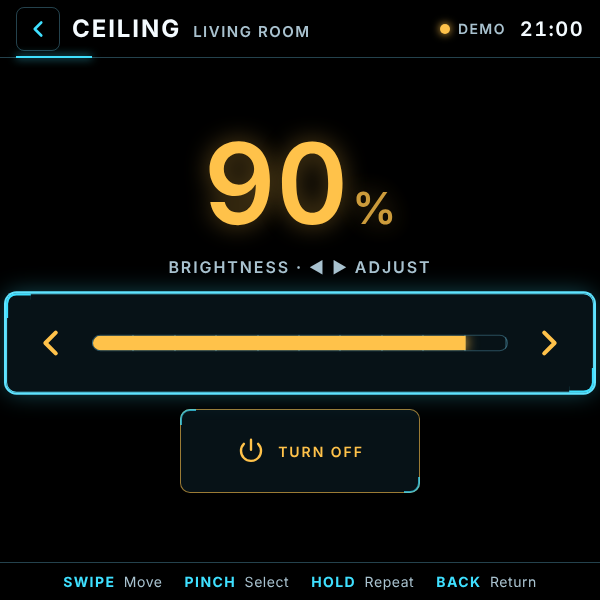

[README.md](https://github.com/user-attachments/files/33912749/README.md)
# Home Deck

A Home Assistant dashboard built for **Meta Ray-Ban Display** glasses: a 600×600, dark, high-contrast HUD that you drive with the Neural Band (swipe to move, pinch to select).

- **Rooms** load automatically from your Home Assistant areas
- **Lights, switches, fans, scenes and scripts** with a single pinch
- **Brightness and thermostat** control: swipe left/right to adjust
- **Samsung TV remote**: power, volume, mute, D-pad, home, back, source and playback, with hold-to-repeat
- **Your token stays secret.** A small server function talks to Home Assistant, so your token never reaches the browser

| Home | Room | Adjust | TV remote |
|---|---|---|---|
|  |  |  |  |

> Black is see-through on the Display's additive screen, so the UI is drawn with light (outlines and glow) rather than solid panels.

---

## What you need

- **Home Assistant** reachable from the internet over HTTPS. A [Nabu Casa](https://www.nabucasa.com/) subscription is the easiest way; any other secure external URL works too.
- A **long-lived access token** from Home Assistant (Profile → Security → Long-lived access tokens). Ideally create a separate Home Assistant user just for this app.
- Free **GitHub** and **Vercel** accounts.
- *Optional:* the **Samsung Smart TV** integration in Home Assistant for the TV remote (see [TV remote](#samsung-tv-remote)).

## Setup

### 1. Copy the code
Fork this repository, or create your own repo with these files:

```
index.html
style.css
app.js
icon-96.png
api/ha.js
```

### 2. Import it into Vercel
In Vercel, choose **Add New → Project** and import the repo.
- **Framework preset:** Other
- **Build command:** leave empty (no build step is needed)
- **Output directory:** leave as default

### 3. Add three environment variables
In the Vercel project, go to **Settings → Environment Variables**:

| Name | Value |
|---|---|
| `NABU_CASA_URL` | Your Home Assistant address, e.g. `https://abcd1234.ui.nabu.casa` (any external HA URL works) |
| `HA_TOKEN` | Your long-lived access token |
| `APP_KEY` | A random password for the app. **Letters and numbers only**, 16–30 characters |

> ⚠️ Avoid symbols in `APP_KEY`. Characters like `&`, `#`, `+` and `%` break the link in step 5.

Then **redeploy** (Deployments → ⋯ → Redeploy). Vercel only picks up variable changes on a new deployment.

### 4. Test it
Open `https://YOUR-PROJECT.vercel.app/?key=YOUR_APP_KEY` in a browser. Your rooms should appear, and the status in the top-right corner should read **Online**.

### 5. Add it to your glasses
In the Meta AI app, add a web app using the same link, **including** `?key=…`. The app remembers the key on the device and hides it from the address bar.

## Using it

| Gesture | Action |
|---|---|
| Swipe | Move between tiles |
| Pinch | Open a room / toggle a device / press a remote button |
| Hold | Repeat (volume, D-pad, seek) |
| Back | Return to the previous screen |

- Tiles with a **›** open an adjust screen (dimmable lights, thermostats). Swipe left or right to change the value, then pinch to confirm.
- **Amber** means on; **cyan** marks your current focus.

**Demo mode:** add `?demo` to the address (or open `index.html` straight from your computer) to try the app with sample data and no Home Assistant.

## Configuration

Settings are in the `CONFIG` block at the top of `app.js`:

| Setting | Default | What it does |
|---|---|---|
| `tvMediaPlayer` / `tvRemote` | `null` (auto-detect) | Set these to your TV's entity IDs if it isn't found automatically, e.g. `'media_player.samsung_tv'` |
| `domains` | lights, switches, fans, climate, scenes, scripts | Which kinds of device to show |
| `dimmableOpensDetail` | `true` | `false` makes a pinch on a dimmable light just toggle it |
| `brightnessStep` | `5` | Brightness change (%) per swipe |
| `pollMs` | `5000` | How often device states refresh (ms) |
| `keys` | arrow keys, Enter, Escape… | Map these to different keys if your input arrives differently |

**Rooms** come from Home Assistant **areas**: assign your devices to areas in Home Assistant. If your token can't read areas (this may need an admin user), the app groups devices by type instead.

## Samsung TV remote

- The **D-pad, Home, Back, Source and Menu** buttons send key commands. These need the `remote.*` entity from Home Assistant's **Samsung Smart TV** integration.
- **Power and volume** work through the TV's `media_player` entity, including when it comes from SmartThings.
- **Turning the TV on from fully off** usually needs Wake-on-LAN set up in the Samsung integration.

## Security

- `HA_TOKEN` is used only by `api/ha.js` on Vercel's servers. **Never put your token in `index.html`, `app.js` or any file the browser loads.** A Vercel website is public even when your Vercel settings are private.
- Every request must carry `APP_KEY`. Without it, the server function rejects the request.
- The function only allows reading states and calling services for lights, switches, fans, climate, scenes, scripts, media players and remotes. Locks, alarms and other domains can't be reached through it.
- If you think your key or token has leaked, revoke the token in Home Assistant, create a new one and change `APP_KEY` in Vercel, then redeploy.

## Troubleshooting

| Message / symptom | Likely cause |
|---|---|
| "Open with ?key=… to connect" | This device hasn't been given the key yet. Open the full `?key=` link once |
| "App key is wrong" | The key in the link doesn't exactly match `APP_KEY`, or the redeploy hasn't finished |
| "Home Assistant rejected the token" | `HA_TOKEN` is wrong, expired or revoked |
| "Can't reach Home Assistant" | Wrong `NABU_CASA_URL`, or Home Assistant / remote access is offline |
| "Server setup incomplete" | One of the three environment variables is missing. Add it and redeploy |
| Rooms appear as "Lights", "Switches"… | Devices aren't assigned to areas, or the token can't read areas |
| D-pad does nothing | No Samsung `remote.*` entity. See [TV remote](#samsung-tv-remote) |
| App icon doesn't show | Check `https://YOUR-PROJECT.vercel.app/icon-96.png` loads, then remove and re-add the web app on the glasses |

## Disclaimer

An independent hobby project. Not affiliated with or endorsed by Meta, Home Assistant / Nabu Casa, Samsung or Vercel. Use at your own risk: you're responsible for the security of your own home setup.
